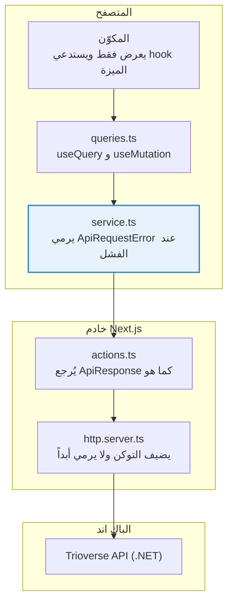

# معمارية واجهة Trioverse: الموقع ولوحة التحكم

Nov 20, 2026 · @yazan

## الهدف والمبادئ

نبني واجهة واحدة لموقع Trioverse العام وللوحة تحكم تديره فوق الباك اند الحالي (ASP.NET Core)، بحيث تصير كل ميزة جديدة نسخة من قالب واحد معروف لكل الفريق.

في أي مشروع يكبر تبدأ الأمور بسيطة: مكوّن يستدعي `fetch` مباشرة، وآخر يخزّن البيانات في حالة محلية، وثالث يعالج الخطأ بطريقته. بعد ثلاثة أشهر لا يعرف أحد أين يضع الكود الجديد، ولا لماذا ظهر الخطأ هنا وليس هناك. هذه الوثيقة تعطي كل جزء من الكود مكاناً واحداً ومهمة واحدة، حتى يقرأ أي مطوّر في الفريق ميزة كتبها غيره ويفهمها خلال دقائق.

طريقة القراءة المقترحة: ابدأ بالصورة الكبيرة والمخطط، ثم انتقل إلى «مثال كامل» لترى كل طبقة بكودها، وأخيراً اقرأ القواعد وأسباب القرارات.

- الموقع العام يُقرأ من الخادم فقط (SSR)، فلا حالة ولا كاش في المتصفح.
- لوحة التحكم تفاعلية: React Query للقراءة والكاش، وServer Actions للتعديل ولحمل التوكن.
- كل ميزة في مجلد واحد يضم كل طبقاتها، ولا مجلدات عامة باسم hooks أو stores.
- الأخطاء تُرجَع كنتيجة ولا تُرمى عبر حدود الخادم والمتصفح، لأن Next يخفي نصها في الإنتاج.
- لكل طبقة مسؤولية واحدة مكتوبة في هذه الوثيقة، وما لا يملك مسؤولية لا يُبنى.

## الصورة الكبيرة

الموقع العام يُقرأ فقط ويحتاج السرعة والفهرسة، واللوحة تُقرأ وتُعدّل وتحتاج تفاعلاً، ومن هذا الفرق تنشأ كل القرارات التالية.

| الجانب | الموقع العام | لوحة التحكم |
| --- | --- | --- |
| من يستخدمه | زوار الموقع والعملاء المحتملون | الفريق الداخلي فقط |
| المسار | `/[lang]/...` (en و ar) | `/dashboard` خارج `[lang]` |
| جلب البيانات | Server Components تستدعي `http` مباشرة | React Query ← Server Action ← `http` |
| الكاش | كاش Next على الخادم (`revalidate`) | كاش React Query في المتصفح (`staleTime` 30 ثانية) |
| اللغة | عربي وإنجليزي عبر next-intl | عربي RTL فقط |
| المصادقة | لا توجد (قراءة عامة) | توكن في cookie من نوع httpOnly (لم يُنفّذ بعد) |
| محركات البحث | مفهرس | `noindex` |

## الطبقات وتدفق البيانات

كل طلب يمر من المكوّن إلى الباك اند عبر خمس طبقات، ويعود الرد بالمسار نفسه، والرمي يحدث في طبقة واحدة فقط.



&#91;embedded content: مسار الطلب · 6 طبقات في 3 مناطق\]

المكوّن يطلب من hook، والـ hook من الـ service، والـ service يستدعي Server Action تعبر إلى الخادم، فيصل `http.server.ts` إلى .NET ويعود الرد كـ `ApiResponse` حتى يحوّله الـ service إلى بيانات أو رمي.

## بنية المجلدات

كل ميزة مجلد واحد فيه كل طبقاتها، وما يُشارك بين الميزات فقط يعيش في `components/ui` و`lib`.

```
lib/
  http.server.ts     عميل .NET الوحيد (لا يرمي أبداً)
  api-response.ts    ApiResponse و unwrap و ApiRequestError
features/
  blog/
    types.ts         واجهات الاستجابة
    schemas.ts       zod: نموذج الإدخال ونوعه
    actions.ts       Server Actions ("use server")
    service.ts       blogService: يلفّ الـ actions ويرمي عند الفشل
    queries.ts       hooks لـ React Query
    components/      واجهة الميزة فقط
components/ui/       مكوّنات مشتركة (Button, Input, Dialog)
app/dashboard/       الصفحات: تستدعي hooks الميزة فقط
```

ميزة جديدة تعني نسخ مجلد `blog` وتبديل الأسماء والمسارات.

## مثال كامل: ميزة blog خطوة بخطوة

لنفترض أننا نريد أن تعرض اللوحة قائمة المقالات وتسمح بإضافة مقال جديد. سنبني الميزة من الأسفل إلى الأعلى، وفي كل خطوة نشرح ماذا نكتب ولماذا هنا بالذات.

### الخطوة 0: الأساس المشترك

هذان الملفان يُكتبان مرة واحدة فقط ويخدمان كل الميزات. الأول يحدد شكل النتيجة التي تعود دائماً من الباك اند، والثاني هو الباب الوحيد الذي يتكلم مع .NET.

`lib/api-response.ts`

```ts
export type ApiResponse<T> =
  | { success: true; data: T; status: number }
  | { success: false; error: string; status: number; details?: unknown };

export class ApiRequestError extends Error {
  constructor(
    message: string,
    public status: number,
    public details?: unknown,
  ) {
    super(message);
  }
}

// للاستخدام داخل service فقط (في المتصفح)
export async function unwrap<T>(request: Promise<ApiResponse<T>>): Promise<T> {
  const r = await request;
  if (!r.success) throw new ApiRequestError(r.error, r.status, r.details);
  return r.data;
}
```

النتيجة تحمل دائماً `success` و`status`، فنفحص `success` قبل أن نلمس `data`. وTypeScript نفسه يمنعنا من قراءة `data` في حالة الفشل، فلا يوجد مسار «ربما انفجر».

`lib/http.server.ts`

```ts
import "server-only";
import { cookies } from "next/headers";
import type { ApiResponse } from "./api-response";

const API_BASE = process.env.API_URL ?? "https://trioverse.runasp.net";
export const TOKEN_COOKIE = "tv_token";

type Options = Omit<RequestInit, "body" | "headers"> & {
  body?: unknown;
  headers?: Record<string, string>;
  auth?: boolean;
};

function messageFrom(d: unknown): string | undefined {
  if (typeof d === "string" && d) return d;
  if (d && typeof d === "object") {
    const o = d as Record<string, unknown>;
    for (const k of ["message", "detail", "title"]) {
      if (typeof o[k] === "string") return o[k] as string;
    }
  }
}

export async function http<T>(
  path: string,
  opts: Options = {},
): Promise<ApiResponse<T>> {
  const { body, headers, auth = true, ...init } = opts;
  const h = new Headers(headers);
  h.set("Accept", "application/json");
  if (body !== undefined) h.set("Content-Type", "application/json");

  try {
    if (auth) {
      const token = (await cookies()).get(TOKEN_COOKIE)?.value;
      if (token) h.set("Authorization", `Bearer ${token}`);
    }

    const res = await fetch(`${API_BASE}${path}`, {
      ...init,
      headers: h,
      body: body !== undefined ? JSON.stringify(body) : undefined,
      cache: "no-store",
    });

    const text = await res.text();
    const parsed: unknown = text ? JSON.parse(text) : undefined;

    if (!res.ok) {
      return {
        success: false,
        status: res.status,
        error: messageFrom(parsed) ?? `HTTP ${res.status}`,
        details: parsed,
      };
    }
    return { success: true, status: res.status, data: parsed as T };
  } catch {
    return {
      success: false,
      status: 0,
      error: "تعذّر الاتصال بالخادم أو أن الاستجابة غير صالحة",
    };
  }
}
```

لاحظ أنه لا يوجد `throw` في أي مكان: حتى انقطاع الشبكة يتحول إلى نتيجة فاشلة برسالة مفهومة. وعندما نضيف تسجيل الدخول لاحقاً سنعدّل هذا الملف وحده، ولا تتأثر أي ميزة.

### الخطوة 1: نصف شكل البيانات والتحقق

قبل أي كود يتكلم مع الشبكة نكتب ما نتعامل معه. ملف `types.ts` يصف ما يعيده الباك اند، وملف `schemas.ts` يصف ما نرسله إليه ويتحقق منه قبل الإرسال. هكذا يعرف النموذج أن العنوان فارغ قبل أن نزعج الخادم.

`features/blog/types.ts`

```ts
export type Post = {
  id: number;
  titleAr: string;
  titleEn: string;
  summeryAr: string; // الاسم كما هو في الباك اند
  summeryEn: string;
  contentAr: string;
  contentEn: string;
};
```

`features/blog/schemas.ts`

```ts
import { z } from "zod";

export const postSchema = z.object({
  titleAr: z.string().min(1, "العنوان العربي مطلوب"),
  titleEn: z.string().min(1, "العنوان الإنجليزي مطلوب"),
  summeryAr: z.string().min(1, "الملخص العربي مطلوب"),
  summeryEn: z.string().min(1, "الملخص الإنجليزي مطلوب"),
  contentAr: z.string().min(1, "المحتوى العربي مطلوب"),
  contentEn: z.string().min(1, "المحتوى الإنجليزي مطلوب"),
});

// نوع الإرسال مشتق من المخطط نفسه، فلا نكتبه مرتين
export type PostInput = z.infer<typeof postSchema>;
```

### الخطوة 2: الـ Server Action هي الجسر

المتصفح لا يستطيع أن يقرأ التوكن (سيكون في cookie من نوع httpOnly)، فلا يكلّم .NET مباشرة. الذي يكلمه هو الـ Server Action، لأنها تعمل على الخادم. وهي هنا تكاد تكون فارغة عمداً: تستدعي `http` وتُرجع نتيجته كما هي، دون `try/catch` ودون رمي.

`features/blog/actions.ts`

```ts
"use server";

import { http } from "@/lib/http.server";
import type { PostInput } from "./schemas";
import type { Post } from "./types";

export async function getPostsAction() {
  return http<Post[]>("/api/BlogPosts");
}

export async function createPostAction(input: PostInput) {
  return http<Post>("/api/BlogPosts", { method: "POST", body: input });
}

export async function deletePostAction(id: number) {
  return http<void>(`/api/BlogPosts/${id}`, { method: "DELETE" });
}
```

سميناها `...Action` ليبقى الاسم الخالي من اللاحقة (`create`، `list`) للـ service الذي يأتي بعدها، فلا يختلط على القارئ أيهما يستدعي.

### الخطوة 3: الـ service يحوّل الفشل إلى رمي

إلى هنا كل شيء يُرجع نتيجة ولا يرمي. لكن React Query لا تفهم النتيجة الفاشلة: هي تعرف أن الاستعلام فشل فقط عندما يُرمى خطأ. فنضع طبقة صغيرة في المتصفح تستدعي الـ actions وتحوّل أي فشل إلى `ApiRequestError`. وهذا هو المكان الوحيد في المسار كله الذي نرمي فيه.

`features/blog/service.ts`

```ts
import { unwrap } from "@/lib/api-response";
import {
  createPostAction,
  deletePostAction,
  getPostsAction,
} from "./actions";
import type { PostInput } from "./schemas";

export const blogService = {
  list: () => unwrap(getPostsAction()),
  create: (input: PostInput) => unwrap(createPostAction(input)),
  remove: (id: number) => unwrap(deletePostAction(id)),
};
```

ولأنها اسم واحد مفهوم لكل عمليات الميزة (`blogService.create`)، فعندما تظهر منطق حقيقي لاحقاً، مثل دمج استدعاءين أو تحويل شكل البيانات، فمكانه جاهز هنا.

### الخطوة 4: الـ hooks تضيف الكاش

هنا يأتي دور React Query: تحفظ نتيجة القائمة في كاش، وتعيد جلبها عندما نخبرها أن شيئاً تغيّر. ننشئ مفاتيح الكاش في مكان واحد (`blogKeys`) حتى لا يكتب كل مطوّر مفتاحاً مختلفاً لنفس القائمة.

`features/blog/queries.ts`

```ts
"use client";

import { useMutation, useQuery, useQueryClient } from "@tanstack/react-query";
import { blogService } from "./service";
import type { PostInput } from "./schemas";

export const blogKeys = {
  all: ["blog"] as const,
  list: () => [...blogKeys.all, "list"] as const,
};

export const usePosts = () =>
  useQuery({ queryKey: blogKeys.list(), queryFn: blogService.list });

export function useCreatePost() {
  const qc = useQueryClient();
  return useMutation({
    mutationFn: (input: PostInput) => blogService.create(input),
    // بعد النجاح: القائمة القديمة لم تعد صحيحة، فنطلب إعادة جلبها
    onSuccess: () => qc.invalidateQueries({ queryKey: blogKeys.all }),
  });
}

export function useDeletePost() {
  const qc = useQueryClient();
  return useMutation({
    mutationFn: (id: number) => blogService.remove(id),
    onSuccess: () => qc.invalidateQueries({ queryKey: blogKeys.all }),
  });
}
```

هذا هو المعادل لما اعتدت عليه في WPF: الكاش مثل مجموعة ملاحَظة تُحدَّث تلقائياً، و`invalidateQueries` هو إشعار «تغيّرت البيانات».

### الخطوة 5: المكوّن يستعمل الـ hook ولا يعرف شيئاً غيره

المكوّن لا يعرف أن هناك Server Action ولا `http` ولا .NET. يطلب البيانات ويعرض الحالات الثلاث: تحميل، خطأ، نتيجة. والرسالة في حالة الخطأ هي **رسالة الباك اند الحقيقية**، لأن الخطأ مرّ سالماً عبر `ApiResponse` ثم `ApiRequestError`.

`app/dashboard/posts/page.tsx`

```tsx
"use client";

import { useDeletePost, usePosts } from "@/features/blog/queries";

export default function PostsPage() {
  const { data, isPending, error } = usePosts();
  const remove = useDeletePost();

  if (isPending) return <p>جارٍ التحميل…</p>;
  if (error) return <p>{error.message}</p>;

  return (
    <ul>
      {(data ?? []).map((p) => (
        <li key={p.id}>
          {p.titleAr}
          <button onClick={() => remove.mutate(p.id)}>حذف</button>
        </li>
      ))}
      {remove.error && <p>{remove.error.message}</p>}
    </ul>
  );
}
```

### كيف أضيف ميزة جديدة؟

الميزة التالية (دراسات الحالة مثلاً) تتبع الخطوات نفسها بالترتيب:

1. أنشئ مجلد `features/<الاسم>` وانسخ `types.ts` و`schemas.ts` ثم عدّل الحقول.
2. اكتب الـ actions: سطر واحد لكل عملية تستدعي `http`.
3. اكتب الـ service: `unwrap` حول كل action.
4. اكتب الـ hooks: استعلام للقراءة، و`useMutation` لكل تعديل مع `invalidateQueries`.
5. ابنِ المكوّنات والصفحة فوق الـ hooks فقط.

إن وجدت نفسك تكتب `fetch` داخل مكوّن أو تضع `try/catch` في action، فأنت خرجت عن المسار، وارجع إلى جدول القواعد أدناه.

## القواعد الملزمة

القاعدة الأهم: الرمي (`throw`) يحدث في المتصفح فقط، وكل ما قبله يُرجع `ApiResponse`.

| الطبقة | يجوز | لا يجوز |
| --- | --- | --- |
| المكوّنات | عرض الواجهة واستدعاء hooks الميزة | استدعاء `fetch` أو الـ actions مباشرة، أو منطق بيانات |
| `queries.ts` | `useQuery` و`useMutation` تلفّان الـ service | منطق عمل، أو استدعاء `http` |
| `service.ts` | رمي `ApiRequestError` عند الفشل، ومنطق الميزة (دمج، تحويل) | أن يُستدعى من كود الخادم، لأن نص الخطأ يُخفى هناك |
| `actions.ts` | `"use server"` وإرجاع `http(...)` كما هو | الرمي أو `try/catch` |
| `http.server.ts` | إرجاع `ApiResponse` دائماً، وإضافة التوكن والهيدرز | الرمي أبداً، أو الاستيراد من كود المتصفح (`server-only`) |
| Zustand | حالة الواجهة فقط (قائمة مفتوحة، فلتر مؤقت) | تخزين بيانات الباك اند، فهذا دور React Query |

### أخطاء شائعة وكيف تُصحَّح

الجدول يقول ما يجوز، وهذه ثلاثة أخطاء نتوقع أن نراها في المراجعة، كل واحد بما يقابله من الصواب.

**1) المكوّن يجلب البيانات بنفسه.** يضيع الكاش وإعادة المحاولة، وتتكرر معالجة الخطأ في كل مكوّن.

```tsx
// خطأ
useEffect(() => {
  fetch("/api/BlogPosts").then((r) => r.json()).then(setPosts);
}, []);

// صواب
const { data } = usePosts();
```

**2) `try/catch` أو `throw` داخل الـ action.** الـ `http` لا يرمي أصلاً، والرمي من Server Action يخفي نص الخطأ في الإنتاج.

```ts
// خطأ
export async function createPostAction(input: PostInput) {
  try {
    return await http<Post>("/api/BlogPosts", { method: "POST", body: input });
  } catch (e) {
    throw e;
  }
}

// صواب
export async function createPostAction(input: PostInput) {
  return http<Post>("/api/BlogPosts", { method: "POST", body: input });
}
```

**3) تخزين بيانات الباك اند في Zustand.** نعيد كتابة الكاش والتحديث بأيدينا، ونفقد ما تقدمه React Query مجاناً.

```ts
// خطأ
const usePostsStore = create((set) => ({
  posts: [],
  load: async () => set({ posts: await blogService.list() }),
}));

// صواب: Zustand لحالة الواجهة فقط
const useUiStore = create((set) => ({
  filtersOpen: false,
  toggleFilters: () => set((s) => ({ filtersOpen: !s.filtersOpen })),
}));
```

## لماذا اخترنا هذا

كل قرار هنا وُضع لسبب محدد، وإن زال السبب يُعاد النظر فيه.

- **لماذا لا نستخدم Server Actions لقراءة الموقع العام؟** لأنها تُنفّذ كـ POST وبالتسلسل ولا تُخزَّن، بينما الموقع العام يستفيد من كاش Next والتوليد على الخادم.
- **لماذا يُرجع العميل `ApiResponse` ولا يرمي؟** لأن Next يخفي نص أخطاء Server Actions المرمية في الإنتاج، فتضيع رسائل التحقق القادمة من .NET.
- **لماذا اتحاد مميّز (`success: true | false`) بدل كائن واحد؟** لأن `data` لا تتاح إلا بعد فحص `success`، فيمنع TypeScript الوصول إليها عند الفشل.
- **لماذا يرمي الـ service في المتصفح؟** لأن React Query تعرف الفشل بالرمي حصراً، وإن أُرجع لها كائن فاشل تعتبره نجاحاً ولا تعيد المحاولة.
- **لماذا `ApiRequestError` وليس `Error` عادياً؟** لأنه يحمل `status` و`details`، فتظهر أخطاء التحقق تحت الحقل الصحيح في النموذج.
- **لماذا لا نولّد الأنواع من Swagger؟** النقاط أربع عشرة ومن يبني الطرفين هو نفسه، فكتابة نوع أو اثنين لكل ميزة أبسط، ونعيد النظر إن كبر الفريق أو تغيّرت الـ DTOs كثيراً.
- **لماذا مجلدات حسب الميزة؟** لأن المجلدات العامة (`hooks/`، `stores/`) تتحول مع الوقت إلى مقبرة لا يعرف أحد ما فيها.
- **لماذا Zustand لحالة الواجهة فقط؟** لأن React Query هي كاش بيانات الخادم، وحفظها في Zustand يعني إعادة كتابة الكاش والتحديث باليد.

## نقاط للنقاش

هذه قرارات لم تُغلق بعد، ورأي الفريق فيها مطلوب.

- **متى تستحق الميزة طبقة `service`؟** نبدأ بها في كل ميزة للتوحيد، لكن هل نكتفي بـ `unwrap` المباشر في الميزات البسيطة؟
- **طابور Server Actions:** إذا شعرنا ببطء في صفحات فيها عدة استعلامات متزامنة، هل ننقل القراءة إلى Route Handlers ونبقي التعديل في الـ Actions؟
- **المصادقة:** تسجيل الدخول وحماية `/dashboard` لم يُنفّذا بعد، ونحتاج إلى قرار في مدة التوكن والتجديد.
- **لغة اللوحة:** عربية RTL فقط الآن، هل سيستخدمها أحد بالإنجليزية؟
- **توليد الأنواع من Swagger:** متى نعيد النظر فيه؟ مقترح: عندما تتجاوز الميزات عشرة أو ينضم مطوّر واجهات لا يعمل على الباك اند.
